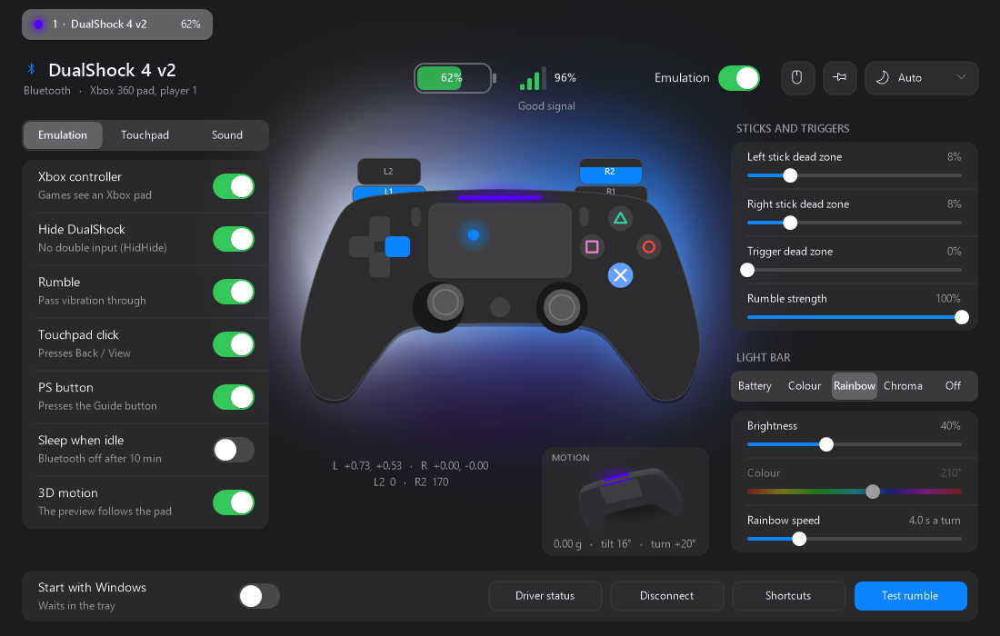
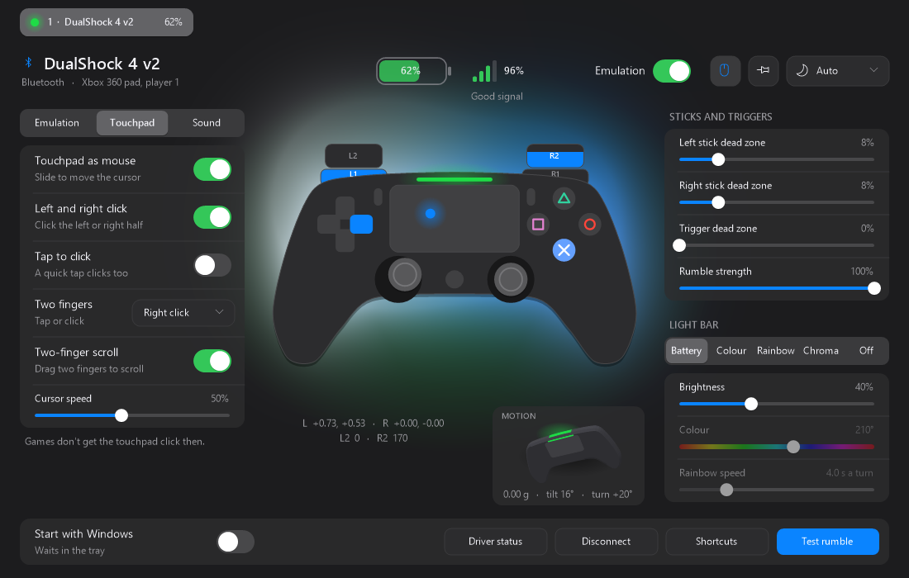
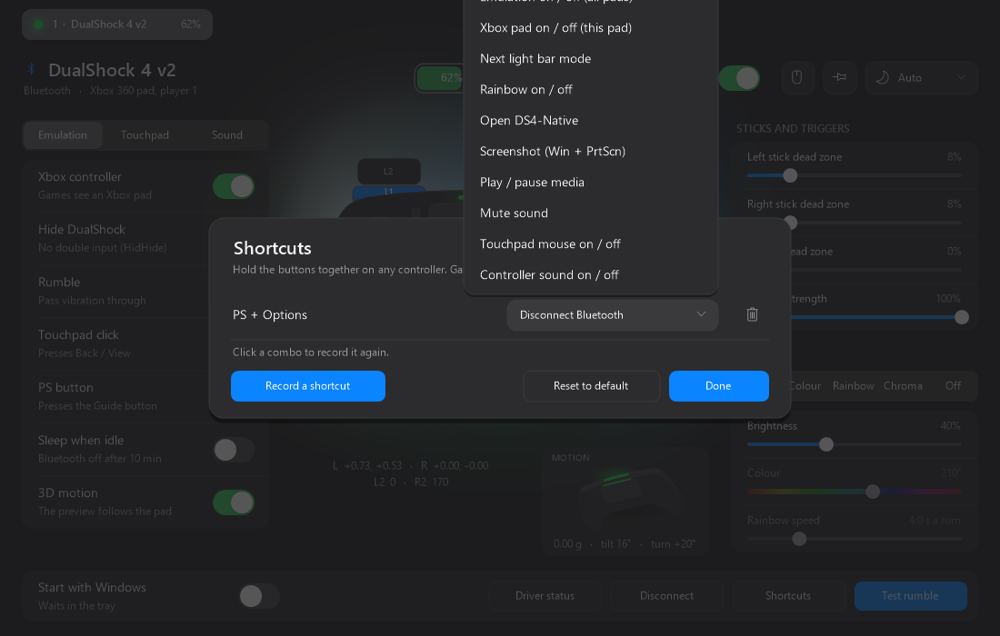
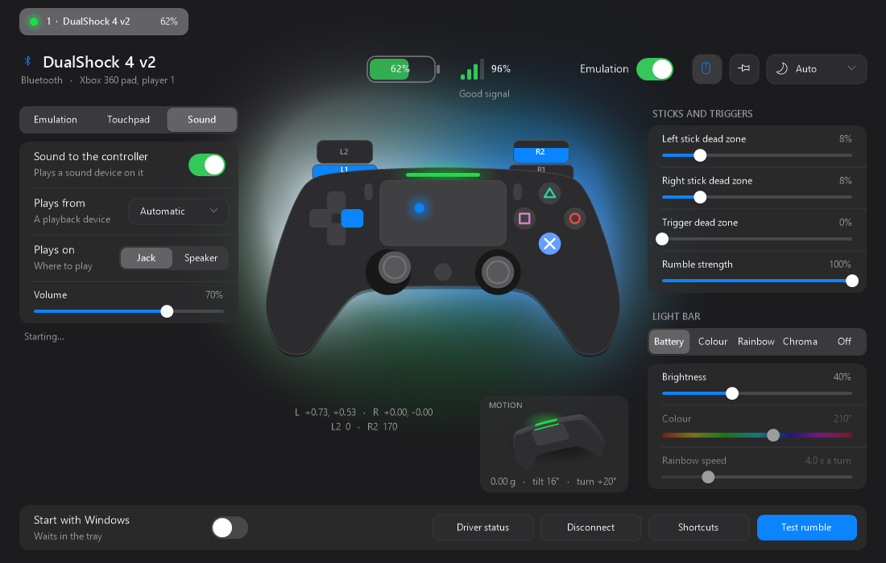

# DS4-Native

A small, native Windows tray app that turns Sony DualShock 4 controllers into Xbox controllers,
in the spirit of DS4Windows, with a live view of the controller and a few extras: Razer Chroma for
the light bar, the touchpad as a mouse, button-combo shortcuts, and sound to the controller's
headphone jack over Bluetooth.

One C++ file, Win32 and GDI+, no .NET or other runtime.



## Features

**Xbox emulation**
- Every DualShock 4 becomes a virtual Xbox 360 controller (XInput) through the
  [ViGEmBus](https://github.com/nefarius/ViGEmBus) driver, so games that only know Xbox pads just work.
- The real controller is hidden from games with [HidHide](https://github.com/nefarius/HidHide), so
  there's no double input. DS4-Native adds itself to HidHide's allow list, hides only the controllers
  it manages, and shows them again when it exits.
- Rumble from games is passed through, with a strength setting.
- Stick and trigger dead zones; the touchpad click and the PS button can press Back and Guide.
- DualShock 4 v1 and v2, over Bluetooth, USB or Sony's wireless adapter; several at once, each with
  its own tab and its own settings (remembered per controller).

**The window**
- Tabs along the top, one per connected controller, with its light-bar colour and battery.
- A live drawing of the controller in the middle: buttons, sticks, triggers and touchpad fingers as
  you use them, with an ambilight: whatever you press, or drag on the touchpad, lights the edge of
  the controller nearest to it.
- A small 3D preview that tilts and turns with the controller's motion sensors.
- Battery, and a signal bar for Bluetooth: Windows doesn't report a classic Bluetooth device's signal
  strength, so it shows the share of the controller's reports that actually arrive.
- Light and dark themes (or follow Windows), always-on-top, start with Windows.

**Light bar**
- Battery colour, any colour you pick, a rainbow with adjustable speed, Razer Chroma, or off; with
  brightness.
- **Razer Chroma**: the light bar can follow your Razer Synapse effects through Chroma Connect. Razer
  only lets apps with an App ID it issued connect, so this needs one; see [Razer Chroma](#razer-chroma).

**Touchpad as a mouse** (switch it on with the mouse button in the header)


- One finger moves the cursor, two fingers scroll, like a laptop touchpad.
- Press the pad to click: the left half left-clicks and the right half right-clicks (or the whole
  pad left-clicks). A press only counts if the finger stays still, so sliding around never clicks.
- Two fingers: right or middle click. Optional tap to click.
- Cursor speed setting. The cursor is placed directly, so Windows' pointer acceleration doesn't
  make the speed uneven.

**Shortcuts**



- Hold buttons together on any controller to run an action: disconnect Bluetooth, emulation on or
  off, next light-bar mode, rainbow, touchpad mouse, controller sound, screenshot, play/pause, mute,
  or open the window.
- Record a combo by holding it; pick the action from a list. **PS + Options disconnects** the
  controller by default.
- Games don't see a combo's buttons, and PS only reaches games as Guide when it isn't starting a
  combo, so the Windows Game Bar doesn't pop up.

**Sound to the controller (Bluetooth, experimental)**



- Plays a Windows playback device through the controller's headphone jack or its speaker, with a
  volume setting.
- Over USB the DualShock 4 is a normal Windows sound device already. Over Bluetooth, sound has to be
  SBC-encoded and sent in Sony's own reports, which DS4-Native does: it captures the chosen playback
  device (WASAPI loopback) and streams it to the controller.
- To give the controller a sound device of its own, install the free
  [VB-CABLE](https://vb-audio.com/Cable/) and leave **Plays from** on Automatic: DS4-Native finds
  "CABLE Input" (or any device you rename to include "DualShock"), and whatever plays there comes out
  of the controller. You can rename it to "DualShock 4" in Windows' sound settings. Mirroring
  everything the PC plays is an option too.
- While sound plays, the controller is asked to fit its input reports around the audio, so neither
  starves the other on the Bluetooth link.

## Install

Download **DS4-Native-Setup** from the [latest release](https://github.com/toasty-wheeler/ds4-native/releases/latest)
and run it. It installs DS4-Native and, if they aren't installed yet, the two drivers it builds on
(Nefarius' own signed installers, run silently):

- [ViGEmBus](https://github.com/nefarius/ViGEmBus), for the virtual Xbox controllers;
- [HidHide](https://github.com/nefarius/HidHide) (a checkbox, on by default), which hides the real
  controller from games.

Windows may ask for a restart after the drivers. The release also has a **portable zip** with just
`DS4Native.exe`, for when the drivers are installed already.

DS4-Native isn't code-signed, so Windows SmartScreen may warn the first time; choose
**More info → Run anyway**.

Uninstalling removes DS4-Native but leaves ViGEmBus and HidHide (other apps use them too); they have
their own entries in Windows' Apps list.

## Requirements

- Windows 10 or 11, 64-bit.
- [ViGEmBus](https://github.com/nefarius/ViGEmBus/releases) for Xbox emulation (included in the setup).
- [HidHide](https://github.com/nefarius/HidHide/releases) to hide the real controller from games
  (optional; included in the setup).
- [VB-CABLE](https://vb-audio.com/Cable/) (optional) for Bluetooth sound from a device of its own.
- Razer Synapse with Chroma Connect, and a Chroma Connect App ID (optional) for Razer Chroma.

Don't run DS4Windows at the same time: both would create an Xbox controller for each DualShock 4.

## Building

You need Visual Studio 2022 or newer with the C++ desktop tools.

```
git clone --recursive https://github.com/toasty-wheeler/ds4-native.git
cd ds4-native\app
build.bat
```

`build.bat` finds Visual Studio's compiler itself and produces `DS4Native.exe`. Run it; it lives in
the tray (double-click the icon for the window).

`setup\package.bat` builds the installer and the portable zip into `dist\` (it needs
[Inno Setup 6](https://jrsoftware.org/isinfo.php) and the GitHub CLI, which it uses to download the
ViGEmBus and HidHide installers it bundles).

## Razer Chroma

Chroma Connect sends Synapse's effect colours to apps Razer has approved, identified by an App ID.
DS4-Native starts with Razer's sample App ID, which Razer only accepts on machines set up for Chroma
development. With an App ID of your own, set it as a string value:

```
HKEY_CURRENT_USER\Software\DS4Native
    ChromaAppId = {xxxxxxxx-xxxx-xxxx-xxxx-xxxxxxxxxxxx}
```

then pick **Chroma** under Light bar again, and turn the app on under Connect in Synapse. Razer's
Chroma DLL runs in a helper copy of DS4-Native, so it can't freeze the controller handling if it
misbehaves. App IDs are requested from Razer through the
[Razer Developer Portal](https://developer.razer.com/contact).

## Settings and troubleshooting

- Settings are kept in `HKEY_CURRENT_USER\Software\DS4Native` (per controller under its Bluetooth
  address).
- **Driver status** in the window lists ViGEmBus, HidHide, Chroma and each controller's connection,
  motion data, link quality and sound statistics.

## Status

Tested with a DualShock 4 v1 over Bluetooth. USB, the v2 and Sony's wireless adapter are supported
by the code but haven't been tried on hardware yet. Bluetooth sound is experimental.

## Credits

[ViGEmBus, ViGEmClient and HidHide](https://github.com/nefarius) by Nefarius; the SBC encoder and
the Bluetooth sound report layout come from [DS4-Sound-Link](https://github.com/abh1shekbana/DS4-Sound-Link)
(MIT). See [THIRD_PARTY_NOTICES.md](THIRD_PARTY_NOTICES.md).
